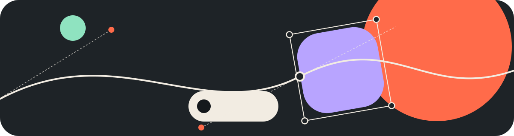
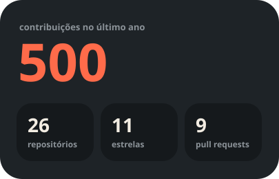
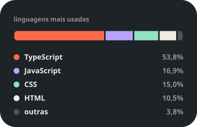

  

  

<h1 align="center">Olá, eu sou a Priscilla :wave: </h1>

  Desenvolvedora Full Stack | React · TypeScript · JavaScript | AI-Augmented Development | Design Background

## :woman_technologist: Sobre mim

Sou desenvolvedora Full Stack, com mais de 4 anos de experiência em projetos web e mobile. Minha maior experiência é com Front-End, principalmente React, JavaScript e TypeScript, mas também trabalho com integrações entre APIs, BFFs e outras partes das aplicações.

Ao longo da minha trajetória, participei do desenvolvimento e da manutenção de produtos B2B e B2C, projetos de redesign e evolução de sistemas em produção.

Também uso ferramentas e agentes de IA, como Claude e Codex, para analisar código, investigar problemas, desenvolver soluções e aprender novas tecnologias. A IA me ajuda a trabalhar com mais agilidade e explorar diferentes possibilidades, mantendo a revisão do código e a validação das soluções.

Antes de migrar para tecnologia, trabalhei por cerca de 8 anos com Design Gráfico. Essa experiência continua contribuindo para meu olhar sobre interfaces, usabilidade e consistência visual.

Comecei minha trajetória em tecnologia com a Gama XP #39, da Gama Academy, onde meu projeto final conquistou o 1º lugar.

## :rocket: Tecnologias e Ferramentas

### Front-End

### Back-End e Integrações

### Mobile

### Outras Tecnologias

### Banco de Dados e Serviços

### Ferramentas de Desenvolvimento e APIs

### Inteligência Artificial

  
  

  

